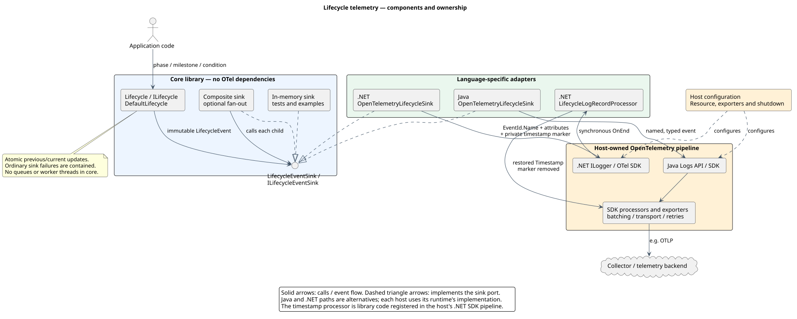
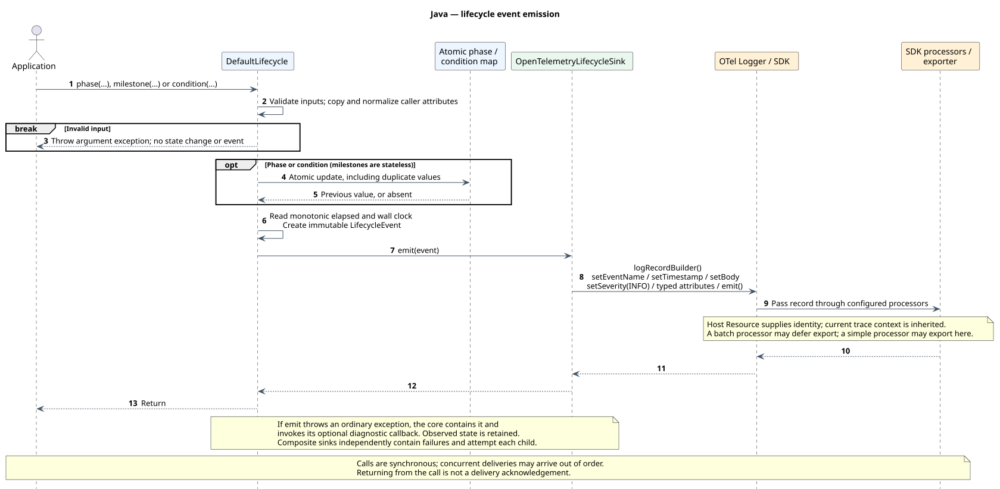
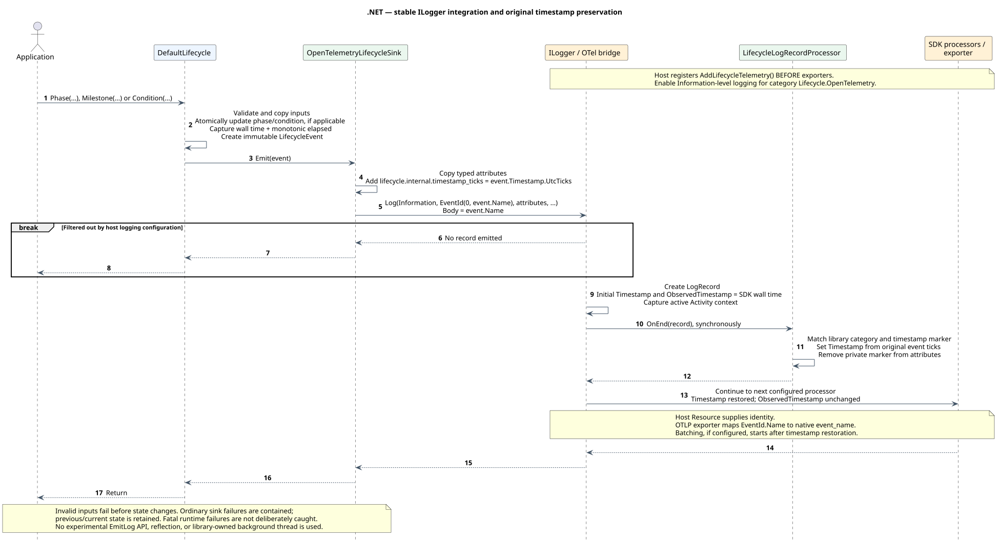
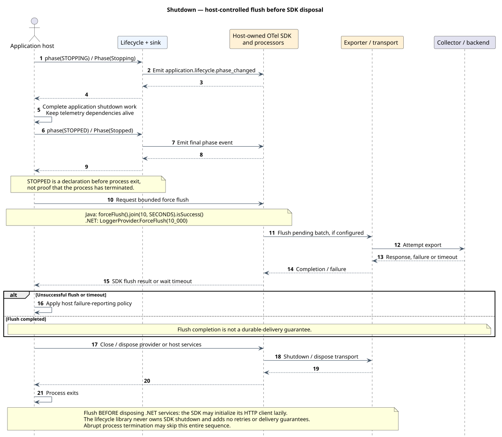

# Architecture diagrams

These diagrams describe the implemented libraries and host responsibilities. The editable
PlantUML sources and rendered SVGs are committed together so GitHub can display them directly.
The [event contract](../event-contract.md) and [architecture notes](../architecture.md)
provide the detailed semantics.

## Components and ownership

[PlantUML source](components.puml) · [SVG](components.svg)



## Java event emission

[PlantUML source](java-emission.puml) · [SVG](java-emission.svg)



## .NET event emission

The timestamp processor runs synchronously before batching/export. It preserves the original
event time while allowing the adapter to use stable ILogger APIs.

[PlantUML source](dotnet-emission.puml) · [SVG](dotnet-emission.svg)



## Shutdown and flushing

The host emits the final phase and flushes while SDK transport dependencies are still alive.
The sample applications emit STOPPING and STOPPED consecutively; real hosts can perform their
application shutdown work between those notifications as shown here.

[PlantUML source](shutdown.puml) · [SVG](shutdown.svg)



## Regenerate

From the repository root, with PlantUML and Graphviz installed:

```sh
plantuml -checkonly -failfast2 docs/diagrams/*.puml
plantuml -tsvg -nometadata -failfast2 docs/diagrams/*.puml
```

Rendered with PlantUML 1.2026.6 and Graphviz 15.0.0. Regenerate the SVGs whenever their
sources change and review the output visually. Diagram tooling is optional and is not needed
for the Maven library build. No remote rendering service or external PlantUML includes are used.
