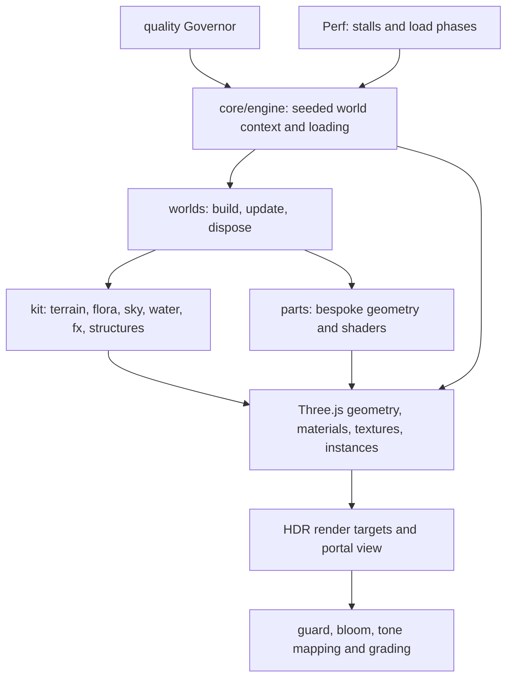

# Portals source architecture and findings

Snapshot: `210133f4e718acb7b461f2a40c90661a40a2397f`. See [scope and reproduction](README.md). Findings below are confirmed from source unless explicitly labelled inference or proposal.

## What builds the image

This is a scene-composition application with shared factories, not a general terrain engine. Worlds combine parameterized algorithms with authored paths, palettes, landmark geometry and timed spectacle. Common factories usually return an object plus uniforms, an update function and sometimes disposal/query functions. Their products are Three.js objects, not renderer-neutral assets.

### Evidence map

| Area | Source and symbols | Confirmed behaviour and interpretation |
|---|---|---|
| World context | [src/core/engine.js](https://github.com/emollick/ai-portals/blob/210133f4e718acb7b461f2a40c90661a40a2397f/src/core/engine.js#L203-L238), `_load` | Injects `THREE`, seeded RNG/noise, renderer, quality hint, yield/frame callbacks and journey variation. Algorithmic injection is useful; journey state is application-specific. |
| Construction scheduling | [engine.js](https://github.com/emollick/ai-portals/blob/210133f4e718acb7b461f2a40c90661a40a2397f/src/core/engine.js#L175-L189), `_yield`, `_frame` | Cooperative main-thread slices and deferred kit work, not background workers. An `async` factory is not evidence of parallel generation. |
| Geometry preparation | [engine.js](https://github.com/emollick/ai-portals/blob/210133f4e718acb7b461f2a40c90661a40a2397f/src/core/engine.js#L326-L405), `_prepare` | Compiles materials for the actual target class, prepares shadow variants, waits for program readiness, uploads textures incrementally, then warm-draws small batches. Addresses first-use work as well as JavaScript construction. |
| World release | [engine.js](https://github.com/emollick/ai-portals/blob/210133f4e718acb7b461f2a40c90661a40a2397f/src/core/engine.js#L530-L579), disposal paths | Calls world disposal and walks geometries, materials, uniform textures, render targets and shadows; excludes selected owned resources. This is explicit WebGL ownership logic, not something Swift ARC alone replaces. |
| Resolution | [src/core/quality.js](https://github.com/emollick/ai-portals/blob/210133f4e718acb7b461f2a40c90661a40a2397f/src/core/quality.js), `TIERS`, `ratioFor`, `Governor.tick` | Pixel budgets, sample/shadow caps and detail hints. Governor samples 90 frame intervals, discards the slowest tenth, lowers resolution below about 43 fps and raises above about 57 fps; can undo futile reductions. Policy targets browser viewing, not a guaranteed 60 fps flight budget. |
| Diagnostics | [src/core/perf.js](https://github.com/emollick/ai-portals/blob/210133f4e718acb7b461f2a40c90661a40a2397f/src/core/perf.js), `Perf.frame`, `load`, `shaders`, `report` | Records late frames, construction/compile/warm phases and browser long tasks. Instrumentation exists; this assessment did not run it. |
| Final appearance | [src/core/post.js](https://github.com/emollick/ai-portals/blob/210133f4e718acb7b461f2a40c90661a40a2397f/src/core/post.js), `Post`, `FinalShader`, `GuardShader` | Half-float HDR path, finite-value guard, UnrealBloomPass with adjusted Gaussian kernels, ACES-like curve, exposure, saturation, contrast, tint, grain and vignette. Some “richness” comes from coordinated grading, not extra geometry. |

## Terrain pipeline

[Core math](https://github.com/emollick/ai-portals/blob/210133f4e718acb7b461f2a40c90661a40a2397f/src/kit/core.js#L5-L134) provides `hashSeed`, `makeRng`, `makeNoise`: seeded permutation simplex 2D/3D, normalized fractal sums, ridged noise and domain warp. `makeRng.fork` consumes its parent's stream; labels alone do not make independent streams stable under build-order changes.

[Height builders](https://github.com/emollick/ai-portals/blob/210133f4e718acb7b461f2a40c90661a40a2397f/src/kit/terrain/heights.js) produce `(x,z) => height` closures. `mountains` combines low-frequency massifs, warp and private `makeEroded`. The latter accumulates analytic value-noise gradients and damps later contributions by accumulated gradient magnitude. This is an **erosion-looking construction**, not hydraulic sediment transport or time-stepped thermal erosion. `canyon`, `mesas`, `stepper` and `terrace` form benches and risers. `karst`, `volcano`, `islands`, `riverValley`, `blend` and `withCorridor` extend composition. These are 2.5D heightfields: they cannot express an overhang or a cave with multiple surface heights at one XZ coordinate.

[Textures](https://github.com/emollick/ai-portals/blob/210133f4e718acb7b461f2a40c90661a40a2397f/src/kit/terrain/textures.js#L116-L163), `makeStrata`, creates bed intervals with colour and hardness, a repeating 512×1 RGBA LUT, and hard-bed transition heights. [heights.js](https://github.com/emollick/ai-portals/blob/210133f4e718acb7b461f2a40c90661a40a2397f/src/kit/terrain/heights.js#L227-L250), `stepper`, uses those transitions for geometry; [material.js](https://github.com/emollick/ai-portals/blob/210133f4e718acb7b461f2a40c90661a40a2397f/src/kit/terrain/material.js#L97-L111) samples the same table for visible bands and relief. **Inference:** sharing a geological model across shape and shading is a better reusable abstraction than independent canyon colour stripes.

[Mesh construction](https://github.com/emollick/ai-portals/blob/210133f4e718acb7b461f2a40c90661a40a2397f/src/kit/terrain/mesh.js), `build`, `finish`, `finish2`, proceeds through:

1. Resolve bounds, biome, strata, base height and optional camera-corridor carving.
2. Build a coarse chamfer distance field around the path and combine focus points. Allocate a dense vertex-ID grid even though the resulting mesh is adaptive.
3. Split quadtree cells by distance and then height variation/centre error within a refinement budget. `maxTriangles` budgets extra refinement using estimates; it is **not a strict cap** on final triangles, mandatory distance refinement or skirts.
4. Reuse grid vertices and fan coarse-cell edges through existing finer neighbours to avoid cracks. Choose quad diagonals using height differences.
5. Derive normals using local-cell central/one-sided differences; build a coarse light grid from the mesh. Sweep the sun shadow ceiling and approximate local ambient occlusion from eight surrounding directions.
6. Generate vertex colours, detail textures, optional perimeter skirts, Three.js buffers, half-float shade texture and material.
7. Expose both mathematical `heightAt`/`normalAt` and triangle-interpolated `surfaceAt`/`surfaceNormalAt`; scatter uses the latter to keep props on the rendered surface.

`makeTerrainAsync` drains the same generator as `makeTerrain`, handing back between checkpoints. It does not remesh continuously with the live camera. **Inference:** static path-focused resolution suits Portals' ride, but would leave player-accessible areas coarse in a freely flown StarFlight scene. For constrained levels prefer prebuilt tiles covering the flyable region; dynamic tile LOD would be new engineering.

## Materials and shader construction

[src/kit/terrain/material.js](https://github.com/emollick/ai-portals/blob/210133f4e718acb7b461f2a40c90661a40a2397f/src/kit/terrain/material.js#L41-L208) builds world-position material effects: macro/mid/fine texture scales, noise-driven slope rock mask, altitude/slope snow, strata, wetness, pebbles, cracks, ripples, tufts, wind drift, cloud-shadow modulation and approximate warm bounce. It switches between top and side fine projections using a noise-dithered decision: **do not describe it as full three-axis triplanar blending**. Derivatives suppress layers when their projected frequency becomes too high. Gradient-packed textures perturb normals; this is not displaced microgeometry.

`inject` ([lines 256–275](https://github.com/emollick/ai-portals/blob/210133f4e718acb7b461f2a40c90661a40a2397f/src/kit/terrain/material.js#L256-L275)) patches Three.js shader chunks for vertex values, colour, roughness, normals, emissive and indirect/direct light. `makeTerrainMaterial`/`makeRockMaterial` select feature defines and share terrain textures and shade data. Preserve the surface model conceptually; replace chunk names, built-in light structs, instancing transforms and implicit colour handling with explicit native shader inputs. A regex translation of GLSL would miss these dependencies.

[src/kit/fx.js](https://github.com/emollick/ai-portals/blob/210133f4e718acb7b461f2a40c90661a40a2397f/src/kit/fx.js#L9-L123) exports `GLSL_HASH`, `GLSL_VALUE_NOISE`, `GLSL_SIMPLEX`, `GLSL_FBM`, `GLSL_VORONOI` and a combined noise string. It includes analytic gradients. Include guards avoid duplicate inclusion but do not namespace global names. The CPU core, sky and fx noise families have different hashes, normalization and octave transforms; replacing all with one implementation changes art direction and reproducibility.

## Sky, depth and vegetation

[src/kit/sky.js](https://github.com/emollick/ai-portals/blob/210133f4e718acb7b461f2a40c90661a40a2397f/src/kit/sky.js), `makeSky`, uses an artistic directional gradient, suns/bodies/stars and projected fractal cloud layers (`cloudLayer`, lines 347 onward). The sampled cloud densities give local self-shadow and silver edges. This is not evidence of a physically integrated planetary Rayleigh/Mie atmosphere. Some expensive celestial features are baked to cubemap/body textures in deferred steps (lines 780–854); dynamic cloud layers are not thereby all baked away.

`makeCloudField`/`cloudFieldSteps` combine instanced puffs and an optional cloud-sea deck. `update` performs 1024-bucket depth sorting and rewrites instance data; cloud appearance is volumetric-looking, without a general 3D scattering solver. `makeLightRig` ([lines 1437–1477](https://github.com/emollick/ai-portals/blob/210133f4e718acb7b461f2a40c90661a40a2397f/src/kit/sky.js#L1437-L1477)) matches hemisphere fill and directional light to sky colours and moves/snaps a shadow rig near the camera.

[src/kit/fx.js](https://github.com/emollick/ai-portals/blob/210133f4e718acb7b461f2a40c90661a40a2397f/src/kit/fx.js#L1046-L1076), `makeGroundFog`, samples terrain once, builds multiple sheets and shades noise-driven transparent fog. Useful atmosphere at a potentially substantial overdraw cost. Three.js fog uniforms/chunks also occur throughout sky, water and fx; there is no single universal atmospheric integration layer.

[src/kit/flora.js](https://github.com/emollick/ai-portals/blob/210133f4e718acb7b461f2a40c90661a40a2397f/src/kit/flora.js), `tube`, `blob`, `skeleton`, species geometry factories, `makeLeafTexture`, `leafMipSteps`, `windMaterial`, `windDepthMaterial`, `makeGrassAsync`: procedural branches/cards, a generated leaf atlas with coverage-conscious mips, wind attributes and a matching shadow deformation path. `makeGrass` chunks instanced cards and fades/sinks distant cover. These are useful plant primitives, not a vegetation ecosystem simulator.

[src/kit/terrain/rocks.js](https://github.com/emollick/ai-portals/blob/210133f4e718acb7b461f2a40c90661a40a2397f/src/kit/terrain/rocks.js), `rockGeometry`, `buildCreased`, `archGeometry`, `cliffGeometry`, `basaltGeometry`: cut/displaced icospheres and specialized formations provide silhouettes a heightfield cannot. `scatter` rejects by height, normal, density, footprint and optional spacing/path clearance. It stops at `count * attempts`, so underfilling is valid. `makeInstances` splits near/far geometry **once using distance to the path**, rather than continuously selecting per-camera LOD.

There is also concrete, narrowly scoped CPU caching: [flora.js, lines 241–266](https://github.com/emollick/ai-portals/blob/210133f4e718acb7b461f2a40c90661a40a2397f/src/kit/flora.js#L241-L266) has `leafCache`, `leafKey`, `leafKeep` and `prepareLeafTexture`. It retains pixel/mip results keyed by size, seed and alpha-test threshold, evicts nondefault entries around a four-entry limit, and creates a fresh Three texture from cached pixels. This is not a persistent asset cache or proof of GPU texture deduplication.

[Horizon ridges](https://github.com/emollick/ai-portals/blob/210133f4e718acb7b461f2a40c90661a40a2397f/src/kit/terrain/horizon.js#L48-L97), `makeHorizonRidges`, are low-poly rings with haze/snow/rim shading; their `update` follows the camera in XZ. They provide inexpensive distant depth, but must remain outside the flyable region; they are not terrain the player can approach and land on.

## Representative composition, not exhaustive world coverage

| Sample and reason | Inspected source | What it demonstrates |
|---|---|---|
| Alpine terrain, closest to snowy StarFlight setting | [worlds/alpenglow-horn.js](https://github.com/emollick/ai-portals/blob/210133f4e718acb7b461f2a40c90661a40a2397f/src/worlds/alpenglow-horn.js#L105-L140), [terrain configuration](https://github.com/emollick/ai-portals/blob/210133f4e718acb7b461f2a40c90661a40a2397f/src/worlds/alpenglow-horn.js#L250-L276), [parts/alpenglow-horn.js](https://github.com/emollick/ai-portals/blob/210133f4e718acb7b461f2a40c90661a40a2397f/src/parts/alpenglow-horn.js#L1-L25) | Shared sky, mountain and terrain factories coexist with bespoke cirrus, hero peak/glacier, lighting and scripted avalanche. Terrain config disables built-in snow in favour of local colour treatment. The finished look is not simply the alpine preset. |
| Custom terrain using the shared mesh | [parts/comet-over-the-lake-town-land.js](https://github.com/emollick/ai-portals/blob/210133f4e718acb7b461f2a40c90661a40a2397f/src/parts/comet-over-the-lake-town-land.js#L51-L124), `makeGround`, `buildTerrain` | Authored lake profile, shelf flattening, noise and custom colour function feed `makeTerrainAsync`; corridor carving is disabled. Shows that shape and mesher are conceptually separable already. |
| Bespoke lighting and visibility | [worlds/backlit-jade-range.js](https://github.com/emollick/ai-portals/blob/210133f4e718acb7b461f2a40c90661a40a2397f/src/worlds/backlit-jade-range.js), `build`, local `ATMOS`, returned `update` | Own atmosphere/water shaders and route-progress visibility switches coexist with kit calls. Hiding forest/gorge groups by journey progress assumes the camera will not turn back. Do not copy that into player flight. |

Kit canyon algorithms were inspected directly even though these samples emphasize mountains and a lake valley. This is a representative dependency/implementation assessment, not a full audit of all 471 world entries or their individual assets.

## Duplication and consolidation opportunities

- RNG arithmetic repeats in sky's `fallbackRng` and core's `makeRng`; path nearest sampling exists both in core and heights' optimized `pathNearest`. Consolidate stable random streams and a renderer-neutral spatial query contract; avoid shared mutable result objects across Swift tasks.
- `icosphere` subdivision exists in rocks and flora; common mesh buffers, subdivision and crease splitting can replace duplicate geometry infrastructure.
- Shader noise appears in fx, sky and world-local strings such as `HORN_NOISE_GLSL` in the alpine part. Consolidate only identical semantics; version distinct noise recipes rather than promising CPU/GPU identity.
- Object factories duplicate material/disposal/update conventions. Native adapters should own GPU resources explicitly; do not export a giant universal scene object protocol merely to mimic the JavaScript return shape.
- Shared strata and surface queries are existing successful consolidation patterns. Carry those boundaries into Swift before adding a general node graph or biome framework.

## Dependencies and performance implications

[index.html](https://github.com/emollick/ai-portals/blob/210133f4e718acb7b461f2a40c90661a40a2397f/index.html#L32-L34) maps bare Three imports to vendored Three.js, release 170 per [notices](https://github.com/emollick/ai-portals/blob/210133f4e718acb7b461f2a40c90661a40a2397f/THIRD-PARTY-NOTICES.txt). Three is not an npm runtime dependency in [package.json](https://github.com/emollick/ai-portals/blob/210133f4e718acb7b461f2a40c90661a40a2397f/package.json); esbuild 0.28.2 is a build-time dependency. Addons include buffer geometry utilities, postprocessing, reflection and geometry helpers. Example: structures imports `mergeGeometries`; interior imports `TeapotGeometry`; the sampled lake part imports `Reflector`. Swift needs neither a browser nor esbuild nor a Three.js wrapper.

No benchmarks were run. Numerical defaults below are source configuration; costs are predictions, not measurements. Source comments claiming microseconds per height call or grass build times lack a reproducible device/test setup here and are not used as native estimates.

| Risk / evidence | Native consequence (prediction) | Proposed handling |
|---|---|---|
| Nested noise octaves and multiple normal/placement samples | CPU cost scales with sample count × recipe work; Swift alone does not remove it | Build off render thread with bounded tasks; cache height tiles and normals; batch contiguous buffers |
| Dense ID grid, JS array intermediates, copies in mesh finish | Adaptive final vertex count understates peak memory | Estimate before allocation; exact/bounded buffers; log peak residency, including staging resources |
| Shared-material instancing/merging | Fewer draws, but large batches reduce culling granularity | Spatially partition instances; budget visible/shadow batches separately |
| Derivative-aware material detail and optional shader branches | Fragment cost, divergence, bandwidth and aliasing can dominate | Few precompiled variants; mipmapped data textures; disable fine layers before lowering geometry quality |
| Cloud sorting rewrites and transparent fog sheets | CPU upload plus fragment overdraw every frame | Limit coverage, sort bounded clusters; choose sky-only clouds before fly-through fields |
| HDR/MSAA, portal targets, bloom, reflection | Extra full-frame memory and passes; reflected views render scene again | Host owns post pipeline; omit portals; profile optional reflections and bloom independently |
| Static baked sun/AO, contact vertex shading | Invalid after terrain edits or significant sun changes; contact loop is vertices × items | Cache by terrain and light parameters; rebake during loading; do not recompute every frame |
| Engine compiles and warm-draws before visibility | Native pipeline compilation/upload can also hitch | Precreate required Metal pipelines and stage resource uploads before entry |
| Governor ignores large hitches and trims slow tail | Average fps can conceal flight stutter | Track p95/p99 and worst frame alongside CPU/GPU timings; thermal and sustained flight runs |

Prefer offline or level-load generation for terrain topology, rock/plant variants, detail/leaf textures, strata LUTs, static AO/sun fields and sky bakes. Prefer per-frame uniforms for wind, drift, sky time and light parameters; bounded visibility/LOD updates may run incrementally. Cache keys must include seed, generator version, recipe, bounds, resolution, palette and relevant lighting. Persistent content-addressed caching is a **proposal**, not an established Portals subsystem.

## StarFlight priorities

| Setting | First visual gains | Later gains / constraints |
|---|---|---|
| Snowy mountain and vegetation | Slope/altitude snow coverage, rock exposure, macro variation, cool fill with warm directional key, matched sky haze | Ridge/valley synthesis, baked terrain shade and shared plant grounding; wind/leaf detail only where visible at flight speed |
| Orange canyon and structures | Coherent strata on cliffs/rocks, surface gradients, joint/crack masks, warm bounce approximation, distant colour haze | Shared bed table for ledges, arch/basalt silhouettes and spaced rubble; structures consume placement/light data without importing gameplay |

Suggested order: surface proof of concept → sky/fog/light consistency → terrain synthesis and baked shade → placement/rocks → selected vegetation. Expensive fly-through clouds, mirror water, architecture generators and hero set pieces follow only a demonstrated need. No claim is made about StarFlight's current draw calls, renderer, lighting or device performance because its source was not inspected.
