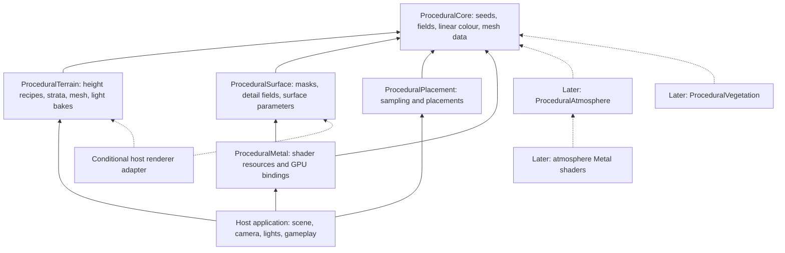

# Proposed Swift architecture

**Proposal only**, grounded in catalogue IDs 01–16. No library, endpoint, manifest or renderer integration has been implemented. This is an in-process toolkit; there is no multi-service API requiring an OpenAPI document.

Underlying source contracts are [height closures](https://github.com/emollick/ai-portals/blob/210133f4e718acb7b461f2a40c90661a40a2397f/src/kit/terrain/heights.js), [mesh surface queries](https://github.com/emollick/ai-portals/blob/210133f4e718acb7b461f2a40c90661a40a2397f/src/kit/terrain/mesh.js) and [surface shader inputs](https://github.com/emollick/ai-portals/blob/210133f4e718acb7b461f2a40c90661a40a2397f/src/kit/terrain/material.js). The module layout below is a new design, not a claim that Portals already provides these boundaries.

## Package shape

Use one initial SPM package, provisionally `ProceduralGraphics`, with small independently importable products. A target boundary does not require a separate repository, release cadence or protocol hierarchy. Consumers should be able to import CPU algorithms without pulling in Metal. Split repositories only when independent ownership or release demand warrants it.



Arrows mean “depends on”. Metal does not need Terrain: it accepts neutral mesh attributes and surface data. Placement takes a surface-query abstraction from Core, not the terrain implementation. Terrain and Surface share a neutral `StrataProfile` data model in Core; the profile builder lives in Terrain, and surface shading can equally consume an authored profile. Put only actually shared types in Core.

| Target / product | Owns | Does not own |
|---|---|---|
| `ProceduralCore` | Stable seed identifiers, versioned deterministic streams, scalar-field and surface query contracts, bounds, linear colours, neutral mesh and image buffers | Scene graph, Apple graphics imports, global RNG, generic service container |
| `ProceduralTerrain` | Height recipes/combinators, strata builder, mesh topology, normals, sampled surface lookup, sun/AO bake | Materials, cameras, collision simulation, world loading |
| `ProceduralSurface` | Surface recipe values, CPU reference masks, tileable height/gradient images, channel/encoding descriptors | Scene lights, graphics device, texture allocation |
| `ProceduralPlacement` | Rejection sampling, bounded attempts, spatial spacing, transforms, per-instance variation | Rock/plant asset selection tied to a game, rendering or collision avoidance for live craft |
| `ProceduralMetal` | Bundled MSL source/library resources, surface evaluation, typed host-to-GPU packing, texture upload helpers and material variant preparation | Display/window ownership, render loop, universal PBR renderer, portals or post pipeline |

Later vegetation would build neutral mesh/atlas/wind descriptors; its GPU wind and depth functions belong in a matching adapter. Atmosphere would expose parameters for directional sky colour and distance haze, with GPU implementations added only after the surface experiment. Do not make water, buildings, animals or a complete shader-node graph initial modules.

## Public contracts — illustrative declarations

The sketches express boundaries and data semantics, not frozen or compilation-tested APIs. Omitted constructors must validate positive dimensions, nonzero scales, finite values and ordered thresholds. Names such as `MeshData`, `LinearRGB` and `StrataProfile` denote toolkit-owned value types, not undocumented Apple types.

```swift
public struct GenerationID: Hashable, Codable, Sendable {
    public let seed: UInt64
    public let algorithmVersion: UInt32
}

public protocol HeightField: Sendable {
    func height(at point: SIMD2<Float>) -> Float
}

public struct SurfaceSample: Sendable {
    public let position: SIMD3<Float>
    public let normal: SIMD3<Float>
}

public protocol SurfaceQuery: Sendable {
    func sample(at point: SIMD2<Float>) -> SurfaceSample?
}

public struct MeshData: Sendable {
    public let positions: [SIMD3<Float>]
    public let normals: [SIMD3<Float>]
    public let colours: [LinearRGB]
    public let indices: [UInt32]
}
```

`HeightField` models the continuous recipe (Portals `mountains`, `canyon`). `SurfaceQuery` models actual mesh triangles (Portals `surfaceAt`); optional results make out-of-bounds explicit instead of silently falling back to a different surface. Neither contract promises overhang support. Use a separate arbitrary mesh query only if a later consumer needs it.

```swift
// ProceduralTerrain: proposed service boundary, no body yet.
public protocol TerrainBuilding: Sendable {
    func build(
        field: any HeightField,
        request: TerrainBuildRequest
    ) async throws -> TerrainAsset
}

// ProceduralPlacement: placement count can be below the request.
public protocol PlacementSampling: Sendable {
    func sample(
        on surface: any SurfaceQuery,
        request: ScatterRequest,
        generation: GenerationID
    ) throws -> PlacementResult
}
```

`TerrainBuildRequest` contains bounds in metres, cell size, region/focus hints, a validated resource budget and optional fixed-sun bake settings. `TerrainAsset` carries mesh, a query acceleration structure and optional shade field; no `SCNNode`, entity or GPU buffer. `ScatterRequest` carries bounds, count, attempt budget, scale range, slope/height ranges, spacing and optional injected density field. `PlacementResult` carries transforms, variation seeds and rejection/underfill statistics. Do not promise exact count when constraints make it impossible.

```swift
// ProceduralSurface: CPU reference for the GPU model.
public struct SurfaceInput: Sendable {
    public let position: SIMD3<Float>
    public let geometricNormal: SIMD3<Float>
    public let macroVariation: Float
}

public struct SurfaceWeights: Sendable {
    public let ground: Float
    public let rock: Float
    public let snow: Float
}

public protocol TerrainSurfaceEvaluating: Sendable {
    func weights(
        at input: SurfaceInput,
        recipe: TerrainSurfaceRecipe
    ) -> SurfaceWeights
}
```

`TerrainSurfaceRecipe` holds linear base/rock/snow colours, slope transition ranges expressed in normal-Y, snow altitude/blend width, world-space detail scale and optional strata profile. The POC uses this subset of `makeTerrainMaterial`, not its entire options dictionary. Evaluated outputs belong to the host lighting model: albedo, roughness and a normal perturbation; do not bake tone mapping or sun exposure into albedo. On CPU tests use supplied macro values rather than pretending shader derivative filtering exists on CPU.

Proposed adapter operation: construct a `MetalSurfaceResources` object from a recipe and pixel buffers using an injected `MTLDevice`; prepare a small surface variant set before scene visibility. The host binds transforms, camera, lights and geometry and incorporates surface outputs in its own shading path. Exact signatures should follow the POC renderer choice; a “render any scene” API would exceed the evidence and scope.

## Rendering adapter decision

Metal-specific work is necessary for MSL translations, explicit resource layouts, samplers, shader derivatives/gradient sampling, wind displacement and GPU shading. CPU noise, height functions, strata, pixel synthesis and placements do not require Metal compute. Start with CPU generation and use compute only after profiling demonstrates a generation bottleneck worth the extra synchronization and parity burden.

Do not implement SceneKit, RealityKit and direct Metal adapters together. **First integration step in a later phase:** inspect StarFlight's actual renderer and minimum OS/device support, then choose one adapter. If its renderer cannot expose the required world-space surface inputs or light integration, demonstrate the component in a tiny Metal host first and explicitly budget the bridge. A direct Metal helper cannot simply be attached to an arbitrary SceneKit/RealityKit material. Any renderer-specific material path needs a capability spike against current official Apple documentation before API commitment.

Neutral mesh conversion is a small optional adapter; native framework material customization and lighting are separate, less portable work. Keep those limitations visible. The POC is allowed a tiny standalone viewer but must not grow a rendering engine.

## Determinism, concurrency and contracts

- Choose one documented PRNG with verified provenance. For any exact adaptation, match JavaScript wrapping arithmetic, unsigned shifts and UTF-16 seed hashing; never use Swift `hashValue` for persistence. Otherwise specify a new versioned seed scheme rather than claiming parity.
- Derive child stream IDs from immutable root seed plus semantic label/tile coordinate, not build order. This intentionally differs from Portals' stream-consuming `fork`; retain a legacy stream only if reference parity is required.
- Guarantee integer stream fixtures and serialized recipes. Floating-point terrain should have documented tolerances; CPU/GPU fast math, fused operations and transcendentals preclude an untested universal bit-exact promise.
- Use immutable `Sendable` recipes and result buffers. No shared scratch vectors or mutable singleton caches. Local loops may mutate owned arrays. Deterministic task partitioning must not change random draws.
- Generate with bounded concurrency and cancellation between batches. A canceled build must not publish a partial asset. GPU creation/submission stays within the adapter's documented scheduling rules.
- Cache neutral results by generation version, recipe, region and resolution. GPU caches are per device and material variant; lighting bakes include sun settings. Host owns eviction budgets and waits until in-flight command buffers stop using resources.
- Use metres, Y-up and a documented right-handed space as the proposed neutral convention. Adapters handle coordinate and winding conversion. Distinguish world-position masks from object coordinates, geometric normals from perturbed normals, linear colour from display colour, and data textures from sRGB images.
- Avoid serializing Swift SIMD memory layout. Use explicit portable scalar encodings for caches and explicit packed GPU structs with verified offsets/alignment.

## Testing and delivery sequence

P0 includes minimal Core/Surface and one adapter/demo target only. P1 adds Terrain/Placement where independent consumers justify them. CPU tests cover fixed seed vectors, finite output, continuity, bounds, normals, triangle indices, strata periodicity and underfill. Mesh tests must exercise adjacent coarse/fine edges and confirm actual triangle/resource caps if the new API promises them; Portals' estimated cap is insufficient.

GPU tests compare reference masks, linear colour, transformed surfaces and filtering across camera distances; wind requires identical visible/depth displacement. Track build time, peak memory, upload cost and steady-state frame distributions separately. License/provenance manifests travel with each distributed target. No release version, minimum OS or renderer compatibility guarantee is assigned before the POC establishes these facts.
